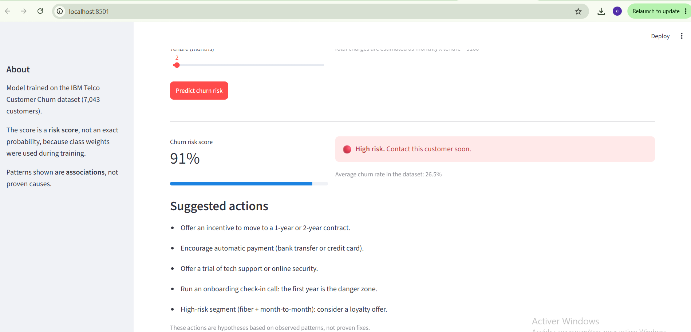
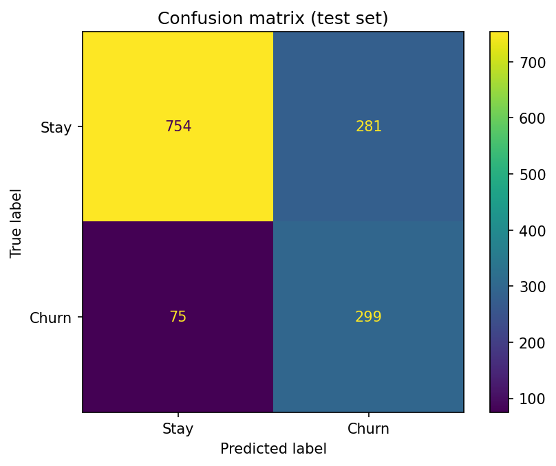
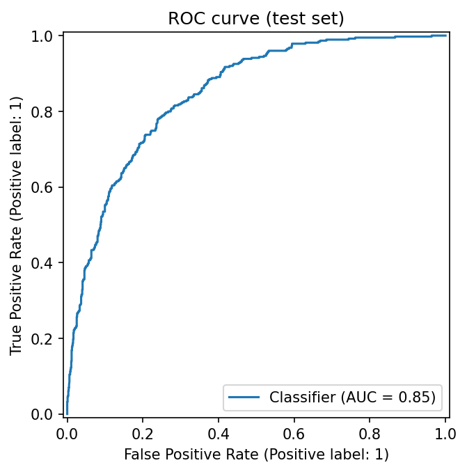
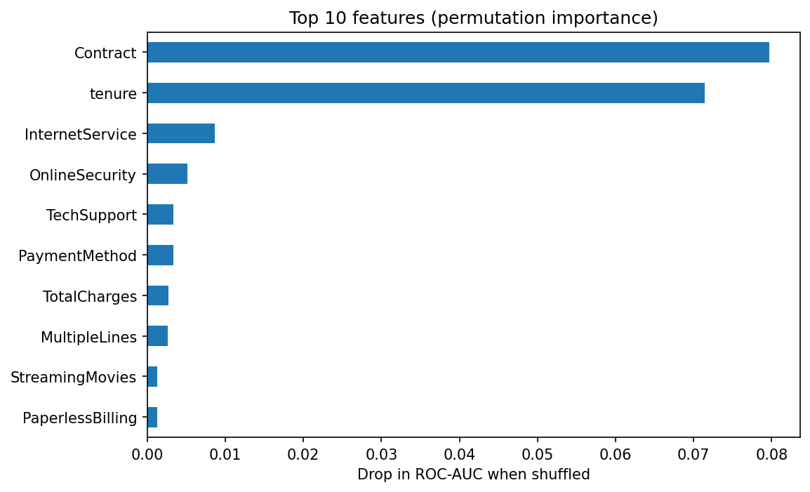
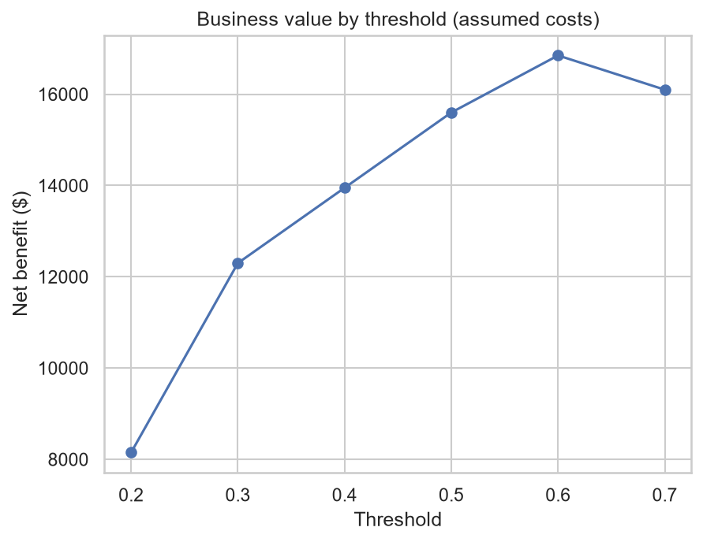
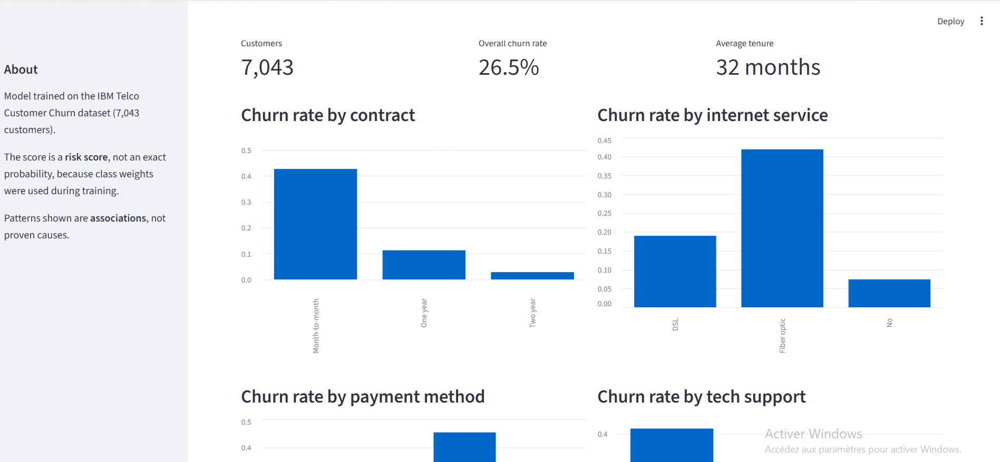
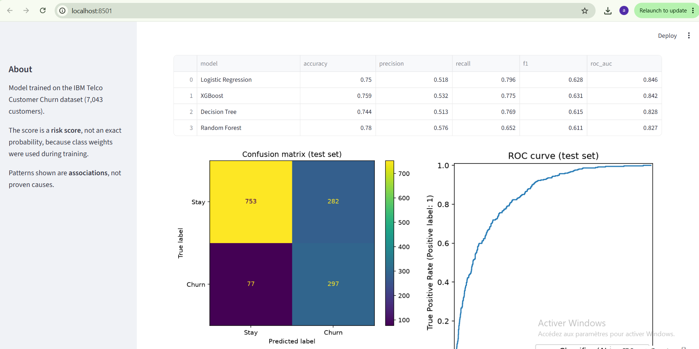

# 📉 Customer Churn Prediction

End-to-end machine learning project that predicts which telecom customers are likely
to leave, explains the main drivers, and serves predictions through an interactive
Streamlit app.




## 🎯 Business problem
Keeping a customer is cheaper than winning a new one. The goal is to identify
at-risk customers early so the company can target retention offers, and to
understand which factors are associated with churn.

## 📊 Dataset
[IBM Telco Customer Churn](https://www.kaggle.com/datasets/blastchar/telco-customer-churn)
(Kaggle): 7,043 customers, 19 features, 26.5% churn rate (imbalanced).
Each row is one customer; the target is `Churn` (Yes/No).

## 🛠️ Tech stack
Python · Pandas · NumPy · Matplotlib · Seaborn · scikit-learn · XGBoost · Streamlit · Git

## 🔄 Workflow
1. **Cleaning:** found 11 hidden missing values in `TotalCharges` (blank text, all with
   tenure = 0), filled with 0 because those customers had not been billed yet
2. **EDA:** 8 charts, each tied to a hypothesis
3. **Feature engineering:** `num_addons`, `is_autopay`, `avg_charge_per_month`, `tenure_group`
4. **Pipeline:** one scikit-learn `Pipeline` (feature creation → scaling and one-hot
   encoding → model), so all learning happens on training data only (no data leakage)
5. **Modeling:** 4 models compared with stratified 5-fold cross-validation
6. **Imbalance:** handled with class weights
7. **Tuning:** `RandomizedSearchCV` on XGBoost (20 combinations)
8. **Evaluation:** test set used once, at the very end
9. **Interpretation:** permutation importance, logistic regression coefficients, risk bands
10. **App:** Streamlit with prediction, risk level, suggested actions and insights

## 📈 Results

Cross-validation on the training set (5 folds):

| Model | ROC-AUC | Recall | Precision | F1 |
|---|---|---|---|---|
| Logistic Regression | 0.846 | 0.796 | 0.518 | 0.628 |
| XGBoost (before tuning) | 0.842 | 0.775 | 0.532 | 0.631 |
| Decision Tree | 0.828 | 0.769 | 0.513 | 0.615 |
| Random Forest | 0.827 | 0.652 | 0.576 | 0.611 |

After tuning with `RandomizedSearchCV`, XGBoost reached a cross-validated ROC-AUC of **0.849**.
Logistic Regression was already very competitive (0.846), so the gain from the more complex
model is marginal. I kept tuned XGBoost as the final model, but Logistic Regression would be
a valid choice when explainability matters most.

**Final model: tuned XGBoost**, evaluated once on the held-out test set (1,409 customers):

| Metric (churn class) | Value |
|---|---|
| ROC-AUC | **0.847** |
| Recall | **79%** (79% of customers who leave are detected) |
| Precision | **51%** (about 1 flagged customer in 2 really leaves) |
| F1-score | 0.62 |

The test ROC-AUC (0.847) is almost identical to the cross-validation score (0.849), which
suggests the model generalizes well and that there is no data leakage. A model that always
predicts "stay" would reach 73.5% accuracy, so accuracy alone is not used to judge the models.

| Confusion matrix | ROC curve |
|---|---|
|  |  |



**Risk bands (test set):**

| Risk band | Customers | Real churn rate |
|---|---|---|
| Low (score < 0.30) | 620 | 4.7% |
| Medium (0.30 to 0.60) | 319 | 23.8% |
| High (score ≥ 0.60) | 470 | 57.2% |

Real churn rises from 4.7% to 57.2%, so the score ranks customers well: high-risk
customers churn about 12 times more often than low-risk ones.

## 🔍 Key findings
These are **associations**, not proven causes:
- **Contract:** month-to-month customers churn at 42.7%, versus 11.3% (one year) and 2.8% (two year)
- **Tenure:** churn is concentrated in the first year of the customer relationship
- **Internet service:** fiber optic customers churn at 41.9%, versus 19.0% (DSL) and 7.4% (no internet)
- **Payment method:** electronic check users churn at 45.3%, versus 15% to 19% for other methods
- **Support services:** customers without tech support churn at 41.6%, versus 15.2% with it
- **Riskiest segment:** month-to-month + fiber optic, with **54.6%** churn
- **Safest segment:** two-year contract without internet, with 0.8% churn

## 💼 Business angle
The decision threshold is a business choice. With assumed values (a saved customer worth
$500, an offer costing $50, 30% acceptance), the best threshold was **0.6**: contacting the
470 customers above it reaches 269 real churners and gives an estimated net benefit of
**$16,850** on the test set. Contacting a group only pays off if more than 33% of its
members would really churn, so the Medium band (23.8% real churn) is not worth targeting
under these assumptions. These figures are illustrative, not real company costs.



## 📱 Streamlit app
The app lets a user enter a customer's profile and returns a churn risk score, a risk
level (Low / Medium / High) and suggested retention actions. It also includes a business
insights tab and a model performance tab.

| Insights | Performance |
|---|---|
|  |  |

## ⚠️ Limitations
- Class weights make the scores **risk scores**, not exact probabilities (for example,
  the High band has a 57.2% real churn rate)
- One dataset from one company; results may not generalize to other businesses
- Findings are associations; proving causes would require an A/B test
- Business-value figures are assumptions, not real costs
- In the app, `TotalCharges` is estimated as monthly charges × tenure

## 🚀 Run it locally
```bash
git clone https://github.com/arij339/customer-churn-prediction-streamlit.git
cd customer-churn-prediction-streamlit
python -m venv venv
venv\Scripts\activate          # Mac/Linux: source venv/bin/activate
pip install -r requirements.txt
python src/train.py            # retrains the model and saves it
python -m streamlit run app/app.py
```

## 📁 Project structure
```
├── app/app.py              Streamlit application
├── data/raw/               original dataset
├── models/                 saved pipeline
├── notebooks/              01 EDA · 02 pipeline check · 03 modeling · 04 interpretation
├── reports/                metrics and figures
└── src/
    ├── features.py         cleaning, feature engineering, pipeline
    └── train.py            training, evaluation, model saving
```

## 🔮 Possible improvements
SHAP explanations · probability calibration · unit tests for `add_features` ·
a second dataset to test generalization


*Dataset: IBM sample data published on Kaggle, used for educational purposes.*